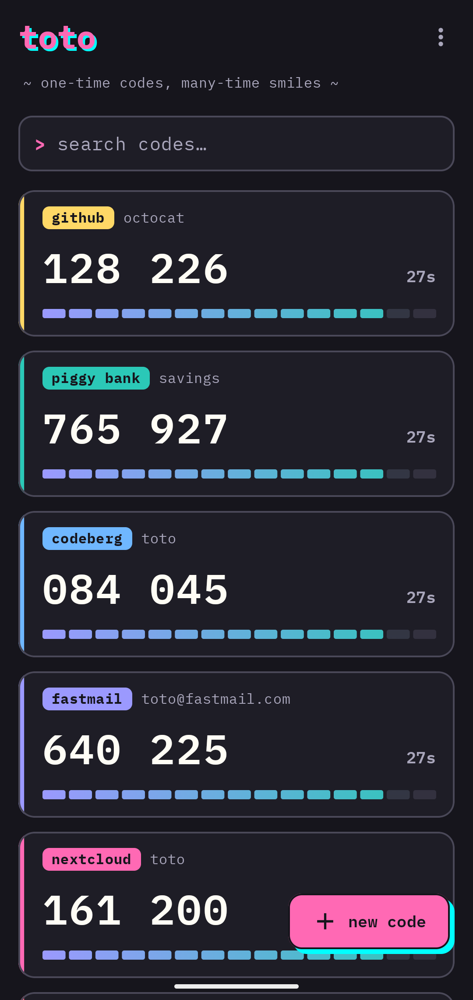
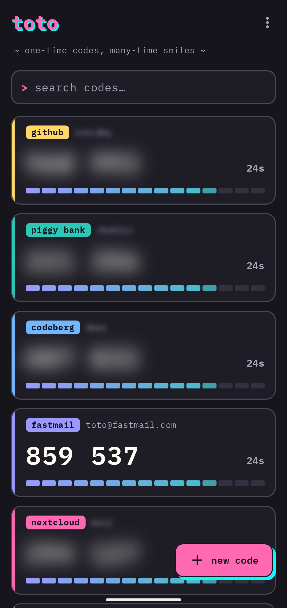
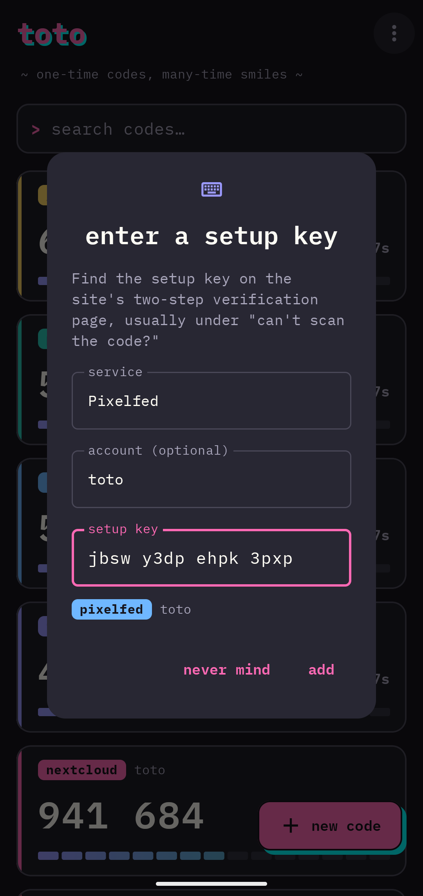
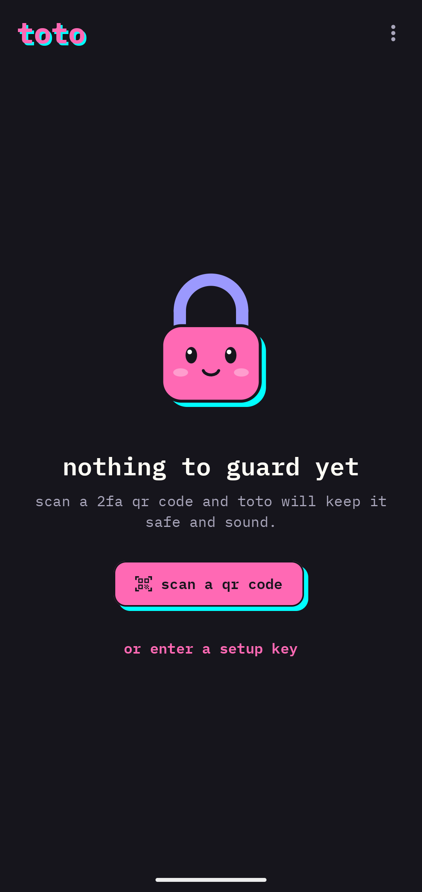
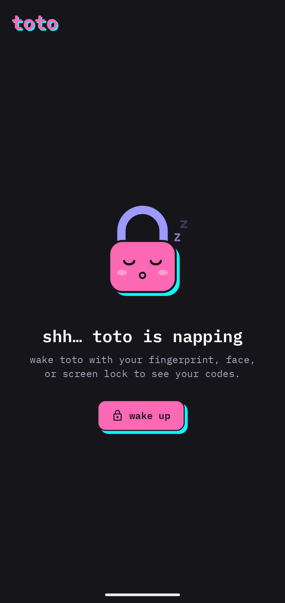

<div align="center">


# Toto

**A cute, offline two-factor authenticator for Android.**

Toto is a tiny lock with one job: Keep your two-step verification codes safe and offline all while being a little bit cute.

<!-- The F-Droid badge goes live once the app is published there -->
<!-- <a href="https://f-droid.org/packages/codes.shandon.toto/"></a> -->

[Features](#features) · [Privacy](#privacy--permissions) · [Install](#install) · [Build](#building-from-source) · [Backups](#backup-format) · [License](#license)

</div>

## Screenshots

<p align="center">
  
  
  
  
  
</p>

## Features

**Adding accounts**
- Scan a QR code with the in-app scanner
- Pick Toto from **Open with** when your camera app scans a 2FA QR code
- Type in a setup key by hand

**Everyday use**
- Big, easy-to-read codes with a countdown bar for the current 30-second window
- Tap to copy. The clipboard entry is marked sensitive so Android hides it in the clipboard preview
- Search by service or account name
- Long-press to rename or remove an account
- **Hide codes** mode: Codes and account names stay blurred until you tap a card, and re-hide after 15 seconds (or when you leave the app)

**Security**
- **App lock** with fingerprint, face unlock, or your screen lock
- Exporting codes requires user authentication

**Backups**
- Export all accounts to a file and encrypt with a an optional password
- Import merges into your existing accounts and skips duplicates

**Looks**
- Terminal-candy styling in IBM Plex Mono, with light and dark themes
- toto, the mascot, who guards your codes and naps when the app is locked

## Privacy & permissions

Toto has **no internet permission**. It **cannot** send your secrets anywhere. It contains no analytics, ads, or tracker.

| Permission | Why |
| --- | --- |
| `CAMERA` | Scanning QR codes. Optional: you can enter setup keys by hand instead |
| `USE_BIOMETRIC` | App lock with fingerprint or face unlock |

Your data stays on your device:
- Accounts are stored in a local database that is **excluded from Android's cloud backup**. Direct device-to-device transfer (cable or "copy from old phone") still carries it over.
- Secrets are never written to the system log.
- Secrets can only be exported by you!

## Supported codes

Toto generates standard **TOTP** codes ([RFC 6238](https://www.rfc-editor.org/rfc/rfc6238)): **6 digits, 30-second period, SHA-1**. That's what the vast majority of sites use, including any site that tells you to use Google Authenticator.

## Install

**Requires Android 15 or newer.**

- **F-Droid:** coming soon, see the badge above.
- **From source:** see below.

## Building from source

### Requirements

- JDK 17 or newer (the JDK bundled with Android Studio works)
- Android SDK with platform 37
- Or simply Android Studio

### Build

```sh
git clone <this repository>
cd <repository folder>

# Debug APK: app/build/outputs/apk/debug/app-debug.apk
./gradlew assembleDebug

# Unsigned release APK: app/build/outputs/apk/release/
./gradlew assembleRelease
```

The build doesn't download a JDK or any tools outside the standard Gradle and Maven repositories, and AGP's encrypted dependency-metadata block is disabled so the APK contains no opaque blobs.

### Tests

```sh
./gradlew testDebugUnitTest
```

Unit tests run on the JVM and cover the backup encryption, the `otpauth://` parser and manual key validation, and QR decoding (real QR codes rendered into camera-style frames).

## Backup format

Backups are UTF-8 JSON files. An **encrypted** backup looks like this:

```json
{
  "format": "sctotp-backup",
  "version": 1,
  "kdf": {
    "algorithm": "PBKDF2WithHmacSHA256",
    "iterations": 600000,
    "salt": "<base64, 16 bytes>"
  },
  "iv": "<base64, 12 bytes>",
  "ciphertext": "<base64>"
}
```

The key is 256 bits derived from your password with PBKDF2-HMAC-SHA256 over the salt. `ciphertext` is AES-256-GCM (128-bit tag) over a JSON array of accounts. Any tampering or a wrong password makes decryption fail.

An **unencrypted** backup stores that array directly:

```json
{
  "format": "sctotp-backup",
  "version": 1,
  "accounts": [
    { "issuer": "GitHub", "username": "octocat", "secret": "JBSWY3DPEHPK3PXP" }
  ]
}
```

`secret` is the base32 setup key. The `format` string predates the app's rename to Toto and is kept as-is so older backups keep importing.

## Project structure

```
app/src/main/java/codes/shandon/toto/
├── MainActivity.kt        Entry point, "Open with" links, file pickers, app-lock prompts
├── TOTPViewModel.kt       State, code loop, lock state, import/export
├── TOTPRepository.kt      Code generation and the account repository
├── Account.kt             Room entity, DAO, and database
├── OtpAuth.kt             otpauth:// parsing and setup-key validation
├── QrDecoder.kt           ZXing QR decoding of camera frames
├── Backup.kt              Backup file format and encryption
├── AppLock.kt             Biometric / screen-lock prompt
└── ui/
    ├── TOTPScreen.kt      Main screen, code cards, menus
    ├── ScannerScreen.kt   CameraX scanner
    ├── AccountDialogs.kt  Add, rename, and confirm dialogs
    ├── BackupPasswordDialog.kt
    ├── Whimsy.kt          toto, chunky buttons, block countdown, pills
    └── theme/             Colors, typography, theme
app/schemas/               Exported Room database schemas (for migrations)
fastlane/metadata/         Store listing text, icon, and screenshots
```

## Contributing

Bug reports and pull requests are welcome. Please open an issue first for larger changes.

- Run `./gradlew testDebugUnitTest` before sending changes.
- If you change the database, bump its version, add a migration, and commit the new schema file that the build writes to `app/schemas/`.
- Keep the app offline and free of non-free dependencies (no Google Play Services, Firebase, ML Kit, or analytics), so it stays eligible for F-Droid.

## License

Toto is free software, released under the **GNU General Public License v3.0 or later**. See [LICENSE](LICENSE).

### Third-party components

| Component | License |
| --- | --- |
| [IBM Plex Mono](https://github.com/IBM/plex) font | SIL Open Font License 1.1 ([`app/src/main/assets/licenses/IBMPlexMono-OFL.txt`](app/src/main/assets/licenses/IBMPlexMono-OFL.txt)) |
| [Material Symbols](https://github.com/google/material-design-icons) icons | Apache License 2.0 |
| [ZXing](https://github.com/zxing/zxing) | Apache License 2.0 |
| [kotlin-onetimepassword](https://github.com/marcelkliemannel/kotlin-onetimepassword) | Apache License 2.0 |
| [AndroidX](https://developer.android.com/jetpack/androidx) (Compose, CameraX, Room, Lifecycle) | Apache License 2.0 |

## Acknowledgements

Toto's look is inspired by [Bitbase.sh](https://bitbase.sh) and the [Charm](https://charm.land) family of terminal tools.

Created with 🍞by [ShandonCodes](http://shandon.codes)
